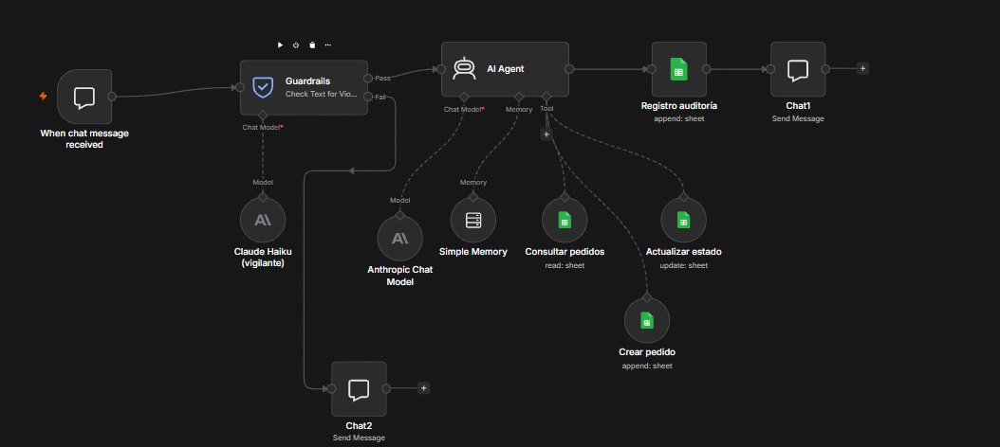

# 🤖 Automatización en n8n para pedidos de clientes

Agente conversacional para la gestión de pedidos de un **taller multiservicio**, construido en **n8n** con modelos **Claude (Anthropic)**. Aplica principios de **gobierno del dato** en cada paso: seguridad, privacidad, minimización, mínimo privilegio y trazabilidad.

## 💬 Qué puede hacer

- **Consultar** un pedido por su ID → *"Dime los datos del pedido P003"*
- **Actualizar** el estado de un pedido → *"Pon el pedido P001 en curso"*
- **Crear** un pedido nuevo → *"Crea el pedido P006 para X persona, teléfono XXXXXXXXX: cambio de tapas, XX €, Pendiente"*

## ⚙️ Cómo funciona

| Paso | Nodo | Qué hace | Principio de gobierno |
|---|---|---|---|
| 1 | **Guardrails (Claude Haiku)** | Bloquea jailbreaks, datos personales sensibles en la entrada (tarjeta, email, IBAN, DNI/NIE) y temas fuera del negocio | Seguridad y privacidad |
| 2 | **AI Agent (Claude Sonnet) + system prompt** | Aplica una política de datos escrita: no inventa datos, consulta solo por ID, no borra registros ni exporta listados | Control blando |
| 3 | **Consultar pedidos** | Solo por ID, un pedido cada vez | Minimización de datos por diseño |
| 4 | **Actualizar estado** | Solo puede modificar la columna `estado` (Pendiente, En curso, Listo) | Mínimo privilegio |
| 5 | **Crear pedido** | Exige todos los datos, comprueba antes que el ID no exista y clasifica la fila como *Confidencial* | Calidad e integridad del dato |
| 6 | **Registro auditoría** | Guarda fecha, sesión, pregunta, herramientas usadas y respuesta | Trazabilidad |

**Decisión de diseño — teléfono del cliente:** el taller necesita el teléfono para avisar al cliente, así que se permite registrarlo y consultarlo. A cambio, cada fila se etiqueta con la clasificación **Confidencial** y todo acceso queda en el registro de auditoría.

## 🧰 Tecnologías

## 🚀 Cómo usarlo

1. Crea una Google Sheet con dos pestañas: `pedidos` (importa `pedidos_ejemplo.csv`) y `log_auditoria` (importa `log_auditoria_ejemplo.csv`).
2. Abre [`agente-ia-automatizacion.json`](agente-ia-automatizacion.json), pulsa **Copy raw file** 📋 y pégalo con **Ctrl+V** en un workflow vacío de n8n (o usa **Import from File**).
3. Configura tus credenciales de **Anthropic** y **Google Sheets**.
4. En los nodos de Google Sheets, sustituye `TU_GOOGLE_SHEET_ID` por el ID de tu hoja.
5. Abre el chat del workflow y prueba los ejemplos de arriba.

> ⚠️ Todos los datos de ejemplo son ficticios. El workflow no incluye credenciales ni datos reales.
